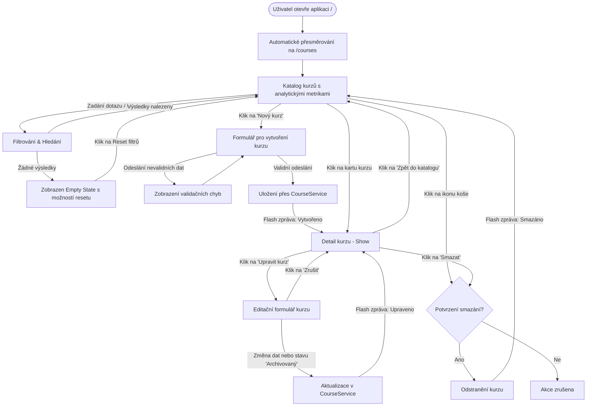

# Akademie Trutnov – Přehled funkcionality a uživatelský postup v drátovém modelu (Wireframes)

> **Dokument:** Uživatelský manuál a drátový model aplikace  
> **Projekt:** Akademie Trutnov – Kurzy vzdělávacího centra (Zadání C)  
> **Předmět:** Pokročilé programování (PPRO), FIM UHK (ZS 2026/2027)  
> **Klient:** Ing. Lucie Bartošová  
> **Architektura:** Čistá 3-vrstvá MVC architektura (Laravel 12, PHP 8.4, Tailwind CSS v4, MySQL 8 v Dockeru)

---

## Obsah
1. [Co aplikace umí (Přehled funkcionality)](#1-co-aplikace-umí-přehled-funkcionality)
2. [Celkový uživatelský diagram (User Flow)](#2-celkový-uživatelský-diagram-user-flow)
3. [Uživatelský postup v drátovém modelu (Krok za krokem)](#3-uživatelský-postup-v-drátovém-modelu-krok-za-krokem)
   - [Krok 0: Globální layout a hlavní navigace](#krok-0-globální-layout-a-hlavní-navigace)
   - [Krok 1: Katalog kurzů a analytická nástěnka](#krok-1-katalog-kurzů-a-analytická-nástěnka)
   - [Krok 2: Filtrování a fulltextové vyhledávání](#krok-2-filtrování-a-fulltextové-vyhledávání)
   - [Krok 3: Vytvoření nového kurzu](#krok-3-vytvoření-nového-kurzu)
   - [Krok 4: Detail kurzu a kontrola osnovy](#krok-4-detail-kurzu-a-kontrola-osnovy)
   - [Krok 5: Úprava parametrů a archivace kurzu](#krok-5-úprava-parametrů-a-archivace-kurzu)
   - [Krok 6: Odstranění kurzu z nabídky](#krok-6-odstranění-kurzu-z-nabídky)
   - [Krok 7: Stav bez výsledků (Empty State)](#krok-7-stav-bez-výsledků-empty-state)
4. [Validace a vynucená byznys pravidla](#4-validace-a-vynucená-byznys-pravidla)
5. [Připravenost na navazující etapy](#5-připravenost-na-navazující-etapy)

---

## 1. Co aplikace umí (Přehled funkcionality)

Systém nahrazuje dosavadní nepřehledné a chybové vedení kurzů v ručně přepisovaných tabulkách v Excelu a Wordu. V aktuální verzi poskytuje ucelenou a robustní správu kmenového katalogu vzdělávacích programů podle standardů PPRO:

### 1.1 Analytický dashboard v reálném čase
- **Okamžitý přehled metrik:** V horní části katalogu se dynamicky kalkulují klíčové statistiky z databáze:
  - Celkový počet aktivně nabízených kurzů.
  - Počet oficiálně akreditovaných kurzů (MŠMT / MPSV) s nárokem na osvědčení.
  - Počet firemních a specializovaných školení na míru.
  - Průměrná hodinová dotace na jeden kurz.

### 1.2 Inteligentní vyhledávání a filtrace
- **Fulltextové vyhledávání:** Okamžité vyhledávání napříč kódem kurzu, jeho názvem i celým textem anotace / osnovy.
- **Rychlé filtrovací záložky (Pills):**
  - *Všechny kurzy* – kompletní katalog.
  - *Pouze akreditované* – filtrování kurzů splňujících ministerská kritéria.
  - *Ostatní / Firemní* – neakreditované specializace.
- **Tlačítko Reset:** Návrat do výchozího stavu jedním kliknutím.
- **Zachování filtrů při stránkování:** URL parametry (`search`, `filter`) se automaticky přenášejí mezi stránkami katalogu (`withQueryString`).

### 1.3 Kompletní správa životního cyklu kurzu (CRUD)
- **Vytvoření kurzu (`create`):**
  - Přidání nového kurzu se zadáním kódu, názvu, hodinové dotace, ceny a podrobné osnovy.
  - Volba, zda jde o akreditovaný program.
- **Přehledová mřížka karet (`index`):**
  - Kartový responsivní design (1 až 3 sloupce dle rozlišení displeje).
  - Vizuální odznaky typu akreditace (`Akreditováno` vs. `Odborný kurz`).
  - Zobrazení kódu, anotace s elegantním třísložkovým zkrácením (`line-clamp-3`), hodinové dotace a česky formátované ceny v Kč (`formatted_price`).
  - Stránkování (9 položek na stránku) chránící výkon při velkém objemu dat.
- **Reprezentativní detail kurzu (`show`):**
  - Exkluzivní tmavý hlavičkový hero blok s přehledem parametrů a datem založení v systému.
  - Plný text anotace a osnovy s respektováním odřádkování.
  - Přípravný blok pro zobrazení přiřazených termínů (vazba 1:N).
- **Úprava parametrů a archivace (`edit`):**
  - Předvyplněný editační formulář.
  - Možnost vyřazení kurzu z veřejné nabídky změnou stavu na `Archivovaný` (takový kurz se nezobrazuje v běžném katalogu, ale historická data zůstávají zachována).
- **Odstranění kurzu (`destroy`):**
  - Možnost trvalého odstranění s klientským bezpečnostním potvrzovacím dialogem (`confirm()`).
  - Flash notifikace o úspěšném smazání.

### 1.4 Zabezpečení dat a architektonické invarianty
- **Striktní 3-vrstvá architektura:** Prezentační vrstva (Blade, Kontroler) pouze předává požadavky do aplikační služby `CourseService`. Logika neprobíhá v šablonách ani v kontrolerech.
- **Vynucení byznys pravidel:**
  - Kód kurzu je vždy unikátní (nelze vytvořit dva kurzy se stejným kódem).
  - Kód kurzu je automaticky normalizován do velkých písmen bez bílých znaků.
  - Hodinová dotace musí být minimálně 1 hodina.
  - Cena nesmí být záporná.
- **Bezpečná manipulace:** Ochrana proti CSRF útokům na všech formulářích, ošetření XSS v Blade šablonách.

---

## 2. Celkový uživatelský diagram (User Flow)

Následující diagram znázorňuje tok uživatele v aplikaci od vstupu do systému až po jednotlivé akce:



---

## 3. Uživatelský postup v drátovém modelu (Krok za krokem)

### Krok 0: Globální layout a hlavní navigace

Každá stránka aplikace sdílí jednotné rozložení s pevnou horní navigační lištou, dynamickou zónou pro flash hlášky a informační patičkou.

```
+-------------------------------------------------------------------------------------------------------+
|  [Logo] AKADEMIE TRUTNOV [PPRO Demo]       Katalog kurzů  /  Termíny (brzy)  Lektoři  Osvědčení     [+ Nový kurz] |
|         Vzdělávací centrum                                                                            |
+-------------------------------------------------------------------------------------------------------+
|                                                                                                       |
|  [ ✓ Kurz byl úspěšně vytvořen a zařazen do nabídky.                                             [x] ] |  <-- Flash box (při akci)
|                                                                                                       |
|  ================================== [ DYNAMICKÝ OBSAH STRÁNKY ] ===================================== |
|                                                                                                       |
+-------------------------------------------------------------------------------------------------------+
|  Akademie Trutnov – Semestrální projekt PPRO 2026/2027  •  Klient: Ing. Lucie Bartošová  •  3-vrstvá  |
+-------------------------------------------------------------------------------------------------------+
```

---

### Krok 1: Katalog kurzů a analytická nástěnka

**Cesta:** `GET /courses`  
Výchozí obrazovka po příchodu do systému. Uživatel vidí souhrnné metriky a mřížku karet s jednotlivými kurzy.

```
+-------------------------------------------------------------------------------------------------------+
| KATALOG A SPRÁVA KURZŮ                                                               [+ Vytvořit nový kurz] |
| Správa vzdělávacích programů, rekvalifikačních a firemních kurzů Akademie Trutnov.                    |
+-------------------------------------------------------------------------------------------------------+
|                                                                                                       |
|  +---------------------+  +---------------------+  +---------------------+  +---------------------+  |
|  | AKTIVNÍ KURZY       |  | AKREDITOVANÉ        |  | FIREMNÍ & OSTATNÍ   |  | PRŮMĚRNÁ DOTACE     |  |
|  |        12           |  |         7           |  |         5           |  |      46.5 hod       |  |
|  | v nabídce centra    |  | s osvědčením MŠMT   |  | spec. školení       |  | na jeden kurz       |  |
|  +---------------------+  +---------------------+  +---------------------+  +---------------------+  |
|                                                                                                       |
|  +-------------------------------------------------------------------------------------------------+  |
|  | [🔍] Hledat podle názvu, kódu či anotace...       Filtr: [ Všechny ] [ Akreditované ] [ Ostatní ] |  |
|  +-------------------------------------------------------------------------------------------------+  |
|                                                                                                       |
|  MŘÍŽKA KURZŮ:                                                                                        |
|  +----------------------------------+  +----------------------------------+                           |
|  | [ REK-UCET-01 ]  [✓ Akreditováno]|  | [ PROG-PYTH-01 ]  [ Odborný kurz]|                           |
|  |                                  |  |                                  |                           |
|  | Účetnictví a daňová evidence     |  | Programování v Pythonu od zákl...|                           |
|  | Intenzivní rekvalifikační kurz   |  | Praktický kurz zaměřený na základy|                           |
|  | zaměřený na podvojné účetnictví..|  | skriptování, automatizaci úloh...|                           |
|  |                                  |  |                                  |                           |
|  | -------------------------------- |  | -------------------------------- |                           |
|  | Hodiny: 120 vyuč. hod            |  | Hodiny: 40 vyuč. hod             |                           |
|  | Cena:   18 500 Kč                |  | Cena:   12 900 Kč                |                           |
|  | -------------------------------- |  | -------------------------------- |                           |
|  | [ Detail kurzu -> ]    [✏️]  [🗑️] |  | [ Detail kurzu -> ]    [✏️]  [🗑️] |                           |
|  +----------------------------------+  +----------------------------------+                           |
|                                                                                                       |
|  Stránkování:  < [1]  2  3 >                                                                          |
+-------------------------------------------------------------------------------------------------------+
```

---

### Krok 2: Filtrování a fulltextové vyhledávání

**Cesta:** `GET /courses?search=ucetnictvi&filter=accredited`  
Uživatel zadá do vyhledávacího pole hledaný výraz nebo klikne na filtr. Seznam se okamžitě zúží a zobrazí se tlačítko pro rychlý reset.

```
+-------------------------------------------------------------------------------------------------------+
|  +-------------------------------------------------------------------------------------------------+  |
|  | [🔍] ucetnictvi                                  Filtr: [ Všechny ] [• Akreditované] [ Ostatní ] [X]|  |
|  +-------------------------------------------------------------------------------------------------+  |
|                                                                                                       |
|  VÝSLEDKY VYHLEDÁVÁNÍ (Nalezen 1 kurz):                                                               |
|  +-------------------------------------------------------------------------------------------------+  |
|  | [ REK-UCET-01 ]                                                                [✓ Akreditováno] |  |
|  | Účetnictví a daňová evidence pro praxi                                                          |  |
|  | Ucelený rekvalifikační program akreditovaný MŠMT pro budoucí samostatné účetní...                |  |
|  |                                                                                                 |  |
|  | Hodinová dotace: 120 vyuč. hodin                 Základní cena: 18 500 Kč                       |  |
|  | ----------------------------------------------------------------------------------------------- |  |
|  | [ Detail kurzu -> ]                                                           [Upravit ✏️] [Smazat🗑️]|
|  +-------------------------------------------------------------------------------------------------+  |
+-------------------------------------------------------------------------------------------------------+
```

---

### Krok 3: Vytvoření nového kurzu

**Cesta:** `GET /courses/create` $\rightarrow$ odeslání přes `POST /courses`  
Formulář s validací všech polí a vizuálním odlišením povinných položek.

```
+-------------------------------------------------------------------------------------------------------+
| [<- Zpět do katalogu kurzů]                                                                           |
|                                                                                                       |
|  +-------------------------------------------------------------------------------------------------+  |
|  | VYTVOŘIT NOVÝ VZDĚLÁVACÍ KURZ                                                                   |  |
|  | Vyplňte základní údaje o programu Akademie Trutnov.                                             |  |
|  | ----------------------------------------------------------------------------------------------- |  |
|  |                                                                                                 |  |
|  |  KÓD KURZU *                                   TYP AKREDITACE                                   |  |
|  |  [ REK-MNG-01                    ]             [X] Akreditovaný kurz (MŠMT / MPSV)              |  |
|  |  (Unikátní identifikátor)                      U akreditovaných kurzů bude vystaveno osvědčení. |  |
|  |                                                                                                 |  |
|  |  NÁZEV KURZU *                                                                                  |  |
|  |  [ Manažerské dovednosti a vedení týmu v praxi                                                ] |  |
|  |                                                                                                 |  |
|  |  HODINOVÁ DOTACE (vyuč. hod.) *                ZÁKLADNÍ CENA (Kč) *                             |  |
|  |  [ 32                            ]             [ 14500                          ]               |  |
|  |                                                                                                 |  |
|  |  PODROBNÁ ANOTACE A OSNOVA KURZU *                                                              |  |
|  |  +-------------------------------------------------------------------------------------------+  |  |
|  |  | Kurz je zaměřen na rozvoj klíčových kompetencí vedoucích pracovníků.                     |  |  |
|  |  | Témata: Situační vedení, delegování úkolů, řešení konfliktů na pracovišti.               |  |  |
|  |  | Absolvent získá praktické nástroje pro vedení týmů ve firemní praxi.                     |  |  |
|  |  +-------------------------------------------------------------------------------------------+  |  |
|  |                                                                                                 |  |
|  | ----------------------------------------------------------------------------------------------- |  |
|  |                                                        [ Zrušit ]   [ Uložit a publikovat kurz ]|  |
|  +-------------------------------------------------------------------------------------------------+  |
+-------------------------------------------------------------------------------------------------------+
```

#### Reakce na chybně zadaná data (Validační stav):
Pokud uživatel zadá již existující kód nebo zápornou cenu, formulář vrátí přehledný alert:
```
+-------------------------------------------------------------------------------------------------------+
|  [ ! Ve formuláři se vyskytly chyby:                                                                  |
|      • Kurz s kódem REK-MNG-01 již v systému existuje.                                                |
|      • Cena kurzu nemůže být záporná. ]                                                               |
+-------------------------------------------------------------------------------------------------------+
```

---

### Krok 4: Detail kurzu a kontrola osnovy

**Cesta:** `GET /courses/{id}`  
Reprezentativní pohled na kurz. Obsahuje hero panel s parametry, plnou anotaci a přípravný kontejner pro termíny.

```
+-------------------------------------------------------------------------------------------------------+
| [<- Zpět do katalogu kurzů]                                            [ Upravit kurz ✏️] [ Smazat 🗑️] |
|                                                                                                       |
|  +-------------------------------------------------------------------------------------------------+  |
|  | HERO PANEL:                                                                                     |  |
|  | [ REK-MNG-01 ]    [✓ Akreditováno MŠMT / MPSV]    [ Stav: Aktivní ]                             |  |
|  |                                                                                                 |  |
|  | Manažerské dovednosti a vedení týmu v praxi                                                     |  |
|  |                                                                                                 |  |
|  | ----------------------------------------------------------------------------------------------- |  |
|  | ROZSAH KURZU:             ZÁKLADNÍ CENA:              ZALOŽENO V SYSTÉMU:                       |  |
|  | 32 vyučovacích hodin      14 500 Kč                   07. 10. 2026                              |  |
|  +-------------------------------------------------------------------------------------------------+  |
|  |                                                                                                 |  |
|  | PODROBNÁ ANOTACE A OBSAH PROGRAMU:                                                              |  |
|  | +---------------------------------------------------------------------------------------------+ |  |
|  | | Kurz je zaměřen na rozvoj klíčových kompetencí vedoucích pracovníků.                        | |  |
|  | | Témata: Situační vedení, delegování úkolů, řešení konfliktů na pracovišti.                  | |  |
|  | | Absolvent získá praktické nástroje pro vedení týmů ve firemní praxi.                        | |  |
|  | +---------------------------------------------------------------------------------------------+ |  |
|  +-------------------------------------------------------------------------------------------------+  |
|                                                                                                       |
|  +-------------------------------------------------------------------------------------------------+  |
|  | TERMÍNY TOHOTO KURZU                            [ Připraveno pro Fázi 2: Entita CourseTerm ]    |  |
|  | ----------------------------------------------------------------------------------------------- |  |
|  | [ 📅 Propojení s termíny kurzu ]                                                               |  |
|  | Zde klientka uvidí konkrétní data konání, učebny, přiřazené lektory a stav obsazenosti         |  |
|  | s čekací listinou po zprovoznění vazby 1:N.                                                    |  |
|  +-------------------------------------------------------------------------------------------------+  |
+-------------------------------------------------------------------------------------------------------+
```

---

### Krok 5: Úprava parametrů a archivace kurzu

**Cesta:** `GET /courses/{id}/edit` $\rightarrow$ odeslání přes `PUT /courses/{id}`  
Umožňuje editaci všech parametrů a přepnutí kurzu do stavu `Archivovaný`.

```
+-------------------------------------------------------------------------------------------------------+
| [<- Zpět na detail kurzu]                                                                    ID: #4   |
|                                                                                                       |
|  +-------------------------------------------------------------------------------------------------+  |
|  | ÚPRAVA KURZU                                                                                    |  |
|  | Aktualizace parametrů kurzu v databázi Akademie Trutnov.                                        |  |
|  | ----------------------------------------------------------------------------------------------- |  |
|  |                                                                                                 |  |
|  |  KÓD KURZU *                                   STAV KURZU *                                     |  |
|  |  [ REK-MNG-01                    ]             [ Aktivní (v nabídce centra)       v ]           |  |
|  |                                                (nebo: Archivovaný - vyřazen)                    |  |
|  |                                                                                                 |  |
|  |  NÁZEV KURZU *                                                                                  |  |
|  |  [ Manažerské dovednosti a vedení týmu v praxi (Inovováno)                                    ] |  |
|  |                                                                                                 |  |
|  |  HODINOVÁ DOTACE *                             ZÁKLADNÍ CENA (Kč) *                             |  |
|  |  [ 36                            ]             [ 15900                          ]               |  |
|  |                                                                                                 |  |
|  |  [X] Akreditovaný kurz (MŠMT / MPSV)                                                            |  |
|  |                                                                                                 |  |
|  |  PODROBNÁ ANOTACE A OSNOVA KURZU *                                                              |  |
|  |  [ Text anotace s aktualizovanou osnovou...                                                   ] |  |
|  |                                                                                                 |  |
|  | ----------------------------------------------------------------------------------------------- |  |
|  |                                                                  [ Zrušit ]   [ Uložit změny ]  |  |
|  +-------------------------------------------------------------------------------------------------+  |
+-------------------------------------------------------------------------------------------------------+
```

---

### Krok 6: Odstranění kurzu z nabídky

**Cesta:** `DELETE /courses/{id}`  
Bezpečný proces smazání chránící před nechtěným kliknutím.

```
                          +--------------------------------------------------+
                          |  Dotaz prohlížeče:                              |
                          |  "Opravdu chcete tento kurz odstranit?"          |
                          |                                                  |
                          |            [ Zrušit ]       [ OK / Smazat ]      |
                          +--------------------------------------------------+
                                   |                           |
                            (Klik na Zrušit)            (Klik na OK)
                                   |                           |
                                   v                           v
                           Žádná akce, kurz           Kurz smazán v databázi,
                           zůstává beze změny         přesměrování na katalog
                                                      s flash hláškou:
                                                      [ ✓ Kurz byl úspěšně odstraněn. ]
```

---

### Krok 7: Stav bez výsledků (Empty State)

Nastává, pokud uživatel zadá vyhledávací dotaz, pro který neexistuje žádný kurz, nebo jsou aplikovány příliš restriktivní filtry.

```
+-------------------------------------------------------------------------------------------------------+
|  +-------------------------------------------------------------------------------------------------+  |
|  | [🔍] asdfghjk_neexistuje                          Filtr: [• Všechny] [ Akreditované ] [ Ostatní ]|  |
|  +-------------------------------------------------------------------------------------------------+  |
|                                                                                                       |
|  + - - - - - - - - - - - - - - - - - - - - - - - - - - - - - - - - - - - - - - - - - - - - - - - - +  |
|  |                                                                                                 |  |
|  |                                           [ 📁 ]                                                |  |
|  |                                NEBYLY NALEZENY ŽÁDNÉ KURZY                                      |  |
|  |   Pro zadaná vyhledávací kritéria neexistuje žádný záznam, nebo katalog neobsahuje žádné kurzy. |  |
|  |                                                                                                 |  |
|  |                             [ Zrušit filtry ]    [ Vytvořit první kurz ]                        |  |
|  |                                                                                                 |  |
|  + - - - - - - - - - - - - - - - - - - - - - - - - - - - - - - - - - - - - - - - - - - - - - - - - +  |
+-------------------------------------------------------------------------------------------------------+
```

---

## 4. Validace a vynucená byznys pravidla

Systém garantuje integritu dat na třech úrovních:

| Pravidlo / Invariant | Vynucení na úrovni UI (HTML5) | Vynucení v Request validaci | Vynucení v Byznys vrstvě (`CourseService`) |
|---|:---:|:---:|:---:|
| **Povinnost kódu a názvu** | `required` atribut | `'required', 'string', 'max:50'` | Kontrola existence hodnot |
| **Unikátnost kódu kurzu** | — | `Rule::unique('courses', 'code')` | `Course::where('code', ...)->exists()` s výjimkou |
| **Normalizace kódu** | — | — | `strtoupper(trim($code))` |
| **Minimální rozsah $\ge 1$ hodina** | `min="1"`, `max="1000"` | `'integer', 'min:1', 'max:1000'` | Kontrola `duration_hours <= 0` vyhazuje chybu |
| **Nezáporná cena ($\ge 0$ Kč)** | `min="0"`, `step="100"` | `'numeric', 'min:0'` | Kontrola `price < 0` vyhazuje chybu |
| **Ochrana před smazáním nechtěně** | JavaScript `confirm()` | CSRF token ověření | RESTful DELETE metoda |

---

## 5. Připravenost na navazující etapy

Aktuální modul kurzu je základním stavebním kamenem pro další rozvoj dle zadání klienta (Ing. Lucie Bartošová):

1. **Entita `CourseTerm` (Termíny kurzu):**
   - Vazba 1:N z kurzu na termíny. Každý termín bude mít učebnu, kapacitu a časové ohraničení.
2. **Entita `Registration` & Čekací listina (Waiting list):**
   - Vynucení striktního pravidla nepřekročitelnosti kapacity učebny a FIFO posunu náhradníků s časovým zámkem 24 hodin (Rozhodnutí 2 v [README.md](README.md)).
3. **Evidence lektorů a lekcí:**
   - Možnost střídání dvou lektorů na jednom běhu kurzu s přesným rozpadem odučených hodin pro výkazy (Rozhodnutí 5 v [README.md](README.md)).
4. **Vydávání osvědčení:**
   - Automatický výpočet 70% docházky studenta a generování unikátního evidenčního čísla certifikátu (Rozhodnutí 1 v [README.md](README.md)).

---
*Vytvořeno v rámci předmětu Pokročilé programování (PPRO) – FIM UHK (ZS 2026/2027).*
